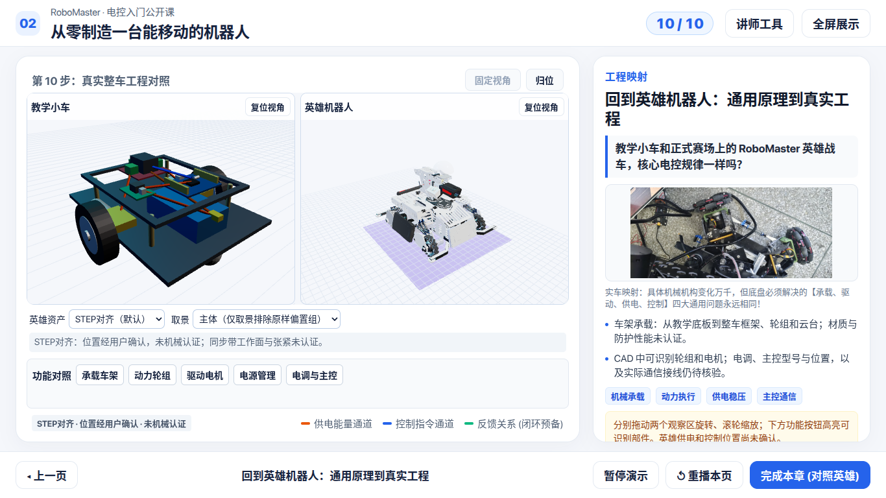
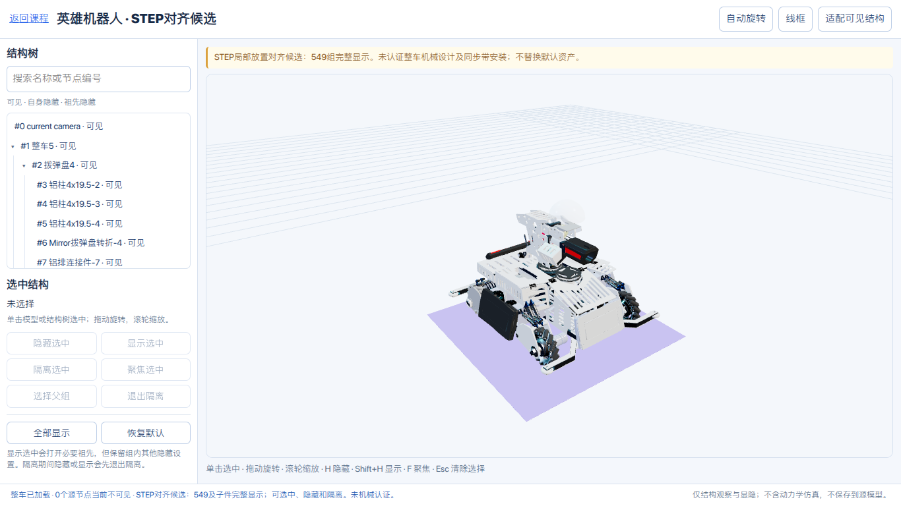
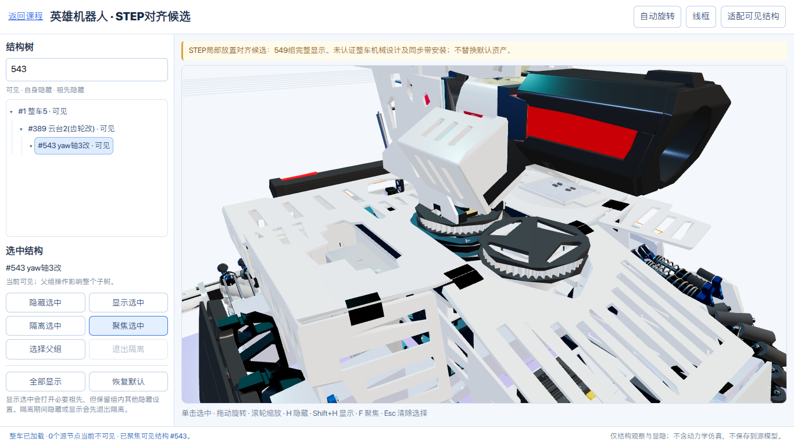

# STEP对齐与默认模型接入阶段完成报告

## 结论与入口

已将原 GLB 中悬空的 `Yaw轴装配体2.1改` 的 **11 个子件（#550–560）**恢复为用户提供 STEP 中的局部放置。#549 本身仍是单位变换；不再通过给父组施加负平移来抵消重复偏移。

启动 `bash scripts/run_server.sh 8080`，访问：

- 结构查看默认入口：<http://127.0.0.1:8080/viewer_full.html>
- 课堂第10步：<http://127.0.0.1:8080/ui-v2.html?step=10>

用户确认位置后，两个默认入口均加载 `web/models/hero_robot_step_aligned.glb`，完整显示 #549，不再默认隐藏。保留点选、结构树、显隐、隔离及聚焦。`?assembly=step` 旧预览链接仍有效；显式 `?assembly=original` 和 `?assembly=inferred` 分别访问原样参考与旧推定版本，课堂下拉框也可切换三种版本。

本轮只改变默认加载选择，不覆盖原始 GLB、旧候选或 STEP，不添加同步带网格或运动联动。V1历史页与装配工作台仍使用原样源文件。STEP版的位置已经用户确认，不升级为机械认证；任一版本加载失败会明确提示，不静默切回原样。

**通过的是与 STEP 的局部放置一致性、文件完整性和双分辨率展示，不是整车机械设计认证。**同步带关系由用户确认，STEP 中的零件历史名称保留，不据名称推定传动形式或齿形标准。

## 源文件与证据链

源文件为 SolidWorks 2025 输出的 STEP AP214，159,910,290 bytes，毫米单位。含229个产品定义、658条装配实例关系，按实例路径展开得到685条实例记录；这些数量不能与 GLB 的574个节点直接比较。

| 内容 | SHA-256 |
| --- | --- |
| 用户原 STEP | `315e57be2f96ca55d345b29515488a206bdffdfeee76937ce58bef22b288be5b` |
| 原样 GLB | `f2eefd1ee718e8c0bebd7490968d5b62b4f99a6b640e57905bb3ef940c374baf` |
| STEP 放置候选 GLB | `cfb8cb7d333a7b8a6973424e2b774616604fef250c777530a6cbfa0674c599af` |

原 STEP 留在用户下载目录，不复制进仓库。提取出的约6.8 MiB Yaw STEP 放在 `.tmp/step-alignment/`，保留目标几何、子装配关系及全部前向引用闭包；逆向链接的几何 representation 一并纳入。没有对整车做无界实体导入。

- [装配变换参考](assembly-reference.json)：只保留 Yaw 父组、目标组及11个直接子件的矩阵与实例路径。
- [FreeCAD 实体审计](cad-audit.json)：安装面、圆柱轴线、孔位与9对实体的距离/交叠结果。
- [GLB 对应与恢复报告](alignment-report.json)：11个一一对应关系、单位证据和放置误差。
- [源哈希绑定补丁](../../../web/models/repairs/yaw-step-aligned.json)：可在原样 GLB 上核验、导入；不应用于旧推定候选。

生成器同时固定已审查的关键证据内容摘要，而非只信任 JSON 自报的源哈希。计时与峰值内存不进入摘要；矩阵、实体证据或命名变化须重新核验，不能简单更新哈希绕过检查。命令行重建会重新读取实际原 STEP 及提取文件校验哈希。仓库内单元测试使用已审查快照，不宣称每次运行都重新打开外部 STEP。

## 修复方法

STEP 路径：`整车5 → 云台2(齿轮改) → yaw轴3改 → Yaw轴装配体2.1改`。

1. 从 STEP 的 NAUO、representation relationship、`ITEM_DEFINED_TRANSFORMATION` 和轴系解析局部/世界矩阵。
2. 无界面 FreeCAD 1.1.3 / OpenCascade 7.9.3 独立导入 Yaw 子装配。原始导入组放置为单位变换；子件放置与解析得到的相对矩阵逐项核对，不重复应用 Shape 和父组变换。
3. 原 GLB 的 #543 父链世界平移约为 `(1.280010819, 1.367624966, 1.386149849)`。#549 组内子件又含该偏移，造成重复叠加。STEP 对应子件为正常局部坐标，例如轴承座 `(0, -0.4, 0)` mm、从动轮 `(0, 30.6, 0)` mm。
4. 用名称、平移与旋转共同建立11个唯一实例对应；用底座板、轴承座及轮体三个独立厚度验证 `1 GLB坐标单位 = 1000 mm`，而非靠整车包围盒猜缩放。
5. 将 STEP 的局部平移转换到米，恢复旋转，保留原子件 scale。原父组、全部其他节点、材质、几何及 BIN 块保持不变。

补丁 `verifiedAgainstCAD` 仍为 `false`，避免旧工作台将其误解为已经机械认证；另以 `stepPlacementValidated: true` 明确标识本次实际核验范围。旧 `hero_robot_inferred.glb` 和旧补丁均未修改，也不叠加到新候选。

## 数值结果与未通过项

| 检查 | 结果 | 判定范围 |
| --- | --- | --- |
| 11子件解析矩阵与独立导入矩阵 | 最大差低于 `1e-8` | 毫米平移与无量纲旋转元素的数值交叉检查，不是统一物理公差 |
| 恢复后子件原点相对 STEP 世界位置 | 最大约 `0.000061215 mm` | 未改原父链的导出舍入差，不是网格表面误差或制造精度 |
| 两带轮轴线夹角 | 本次数值计算为 `0°` | 静态轴线平行，不涉及轴承游隙 |
| 两轴中心距 | 约 `115 mm` | 保留 STEP 设计位置，不据此选带长 |
| 轴承座底面与底座板顶面 | 间隙约为数值零 | 安装面接触 |
| 对应安装孔 | 6对，最大轴线距离约 `1.14e-13 mm` | 数值重合，不是制造公差；两侧孔径并非完全相同 |
| 其他轴承座孔 | 6个未对应底板孔 | 不把它们计为安装孔校验通过；用途未认证 |
| 指定9对实体交叠体积 | 本次数值计算均为0 | 仅限报告所列配对，不覆盖全车、所有紧固件或运动包络 |
| 两轮轴向外形中心偏差 | **约3 mm**，轴向重叠约8 mm | **不能宣称同步带工作面共面或安装已通过** |

导入检查的轴承座、底板、带轮等目标零件及11个对应子件为有效实体。报告没有认证全部 STEP 产品有效。

尚缺带规格、有效工作面定义、实际带宽、张紧机构和带路由，未校验带长、预紧、包角或同步带齿形匹配。没有为了使页面“看着齐”而把主动轮沿轴向移3 mm，也没有修改 STEP 原装配。其他装配和动力学不在本次验收范围。

## 重建命令

仅维护或复核时运行；正常查看无需 FreeCAD。

```bash
# 项目隔离Python：只读原STEP，生成局部提取文件与完整装配矩阵报告。
.venv/bin/python scripts/step_assembly.py '/home/kekeyuyu/Downloads/整车5.STEP' --extract-yaw

# 系统FreeCAD二进制模块：无GUI，默认2.5 GiB虚拟地址上限，120秒进程超时。
OPENBLAS_NUM_THREADS=1 OMP_NUM_THREADS=1 QT_QPA_PLATFORM=offscreen \
  timeout --signal=TERM --kill-after=5s 120s \
  /usr/bin/python3 scripts/step_yaw_audit.py

# 核验实际源文件及证据，重建候选GLB/补丁；会覆盖同名候选，不覆盖原样GLB。
node scripts/generate_step_alignment.mjs .tmp/step-alignment '/home/kekeyuyu/Downloads/整车5.STEP'
```

`step_assembly.py` 依赖项目 NumPy，`step_yaw_audit.py` 使用系统 FreeCAD 模块，不向系统 Python 安装依赖。不同 FreeCAD/OCC 导入结果若改变关键证据会被拒绝，需要重新核验，不能保证跨版本逐字节一致。实体审计记录约12秒、峰值约198 MiB；不是整车导入或网页总内存指标。

```bash
# 62项Node单元测试（包括STEP恢复与三态选择测试）：不依赖外部STEP/FreeCAD。
npm test

# 4项Python解析器测试。
.venv/bin/python -m unittest discover -s tests -p 'test_step_*.py'

# 本地服务器启动后进行默认STEP及参考入口双分辨率验收；产物写入.tmp。
node scripts/step_alignment_check.mjs http://127.0.0.1:8080
```

## 初次对齐验证（设为默认前）

- Node 单元测试60项、Python解析器测试4项通过；包含错误源文件、证据协同篡改、无效对应、单位错误拒绝和 BIN 不变检查。
- 候选 glTF Validator：0 errors、0 warnings。
- 1920×1080、1366×768：整车与 Yaw 局部取景、11子件加载后坐标、全部显示、隐藏/显示保持视角、隔离退出及当时默认模型隔离通过。
- 原结构查看器、双观察区、V1课堂、V2 P1十步双分辨率和装配编辑器浏览器回归通过。本轮回归输出保存在 `.tmp/step-alignment/`，不更新旧交付截图。
- 纯软件渲染验证，未测课堂硬件帧率/显存。未连接实体设备。上述为设为默认前的验证记录。

## 默认接入后验证

用户确认位置后，默认模型选择已切换为STEP版。原样与旧推定模型仍保留，模型文件和补丁未因默认切换再次改动。

- `npm test`：62项通过；四份GLB校验均为0错误、0警告。
- 默认结构查看页：549完整显示；“恢复默认”恢复全显，点选、隐藏、隔离、取景和保持镜头行为通过。
- V2第10步：默认加载STEP版且纳入549取景；三种资产选择、显式原样/旧推定链接、独立相机、高亮、迟到响应与离开步骤保护通过。
- 切换到STEP失败时保留旧模型、选择器、URL和状态；两个默认入口首次加载遇到503时明确报错，不自动请求其他英雄模型，恢复资源后可以重试。
- V1、V2 P0、P1十步双分辨率、装配编辑器、旧推定补丁等回归通过。证据位于 `.tmp/default-step/`，不覆盖旧交付截图。
- CI已加入默认STEP浏览器检查和第四份模型校验；云端结果须以对应提交的 [GitHub Actions](https://github.com/3Fish3/-1014/actions) 为准，不以本地通过替代云端验收。CI基于随仓库的STEP证据快照验证候选，不在云端重新导入下载目录中的原STEP。
- 同步带工作面、规格、路由、张紧及整车机械设计仍未认证，不新增运动演示。

## 本阶段交付范围

提交到 `feat/hero-assembly-finalize`，不合并或改写 `main`。交付包括STEP只读解析与受限实体审计脚本、对齐模型和补丁、装配及几何证据、三态默认模型接入、回归测试、CI检查和本报告。

- [默认STEP浏览器验收快照](default-browser-report.json)：双分辨率CAD位置、默认显隐与参考入口、首次加载503及恢复重试。
- [课堂双观察区验收快照](default-comparison-report.json)：默认STEP、独立相机、三态切换、高亮、失败和迟到响应保护。
- 四张本报告引用的截图与原始几何证据随提交保存；大量逐步回归截图、日志仍在 `.tmp/`，不混入源码提交。
- 原始159.9 MB STEP、虚拟环境、缓存、临时代理脚本及两份独立的使用文档不在本阶段提交内。原样GLB与旧推定资产保留不改。
- 撤回默认显示选择无需删除资产，可显式访问 `?assembly=original` 或在课堂下拉框选择原样模型。

### 1366×768默认入口截图




### 初次对齐1366×768预览




