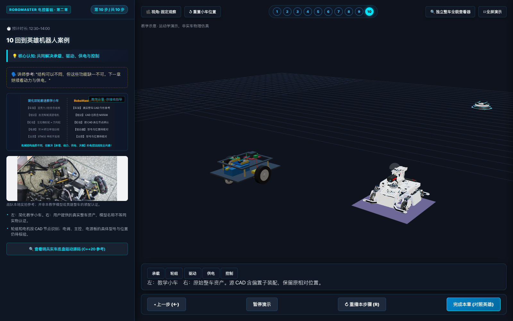

# 第二章设计思路与流程

## 1. 先把教学目标缩小

依据用户《第二章教学定稿 v1.0》，用约14分钟回答：车怎样获得动力、谁决定怎样转、左右轮快慢为何产生转向。不是先教主控型号、CAN帧或PID公式。

十个镜头由讲师手动推进：车架 → 轮组 → 电机 → 驱动器 → 电池/稳压 → STM32 → 三段指令 → 预设运动 → 独立滑块 → 英雄案例对照。预设先于自由调节；滑块不显示RPM、百分比或PWM数字。

## 2. 模型分工与装配演进

- **教学小车**：程序化算法生成，轮轴局部原点居中，左轮位于 -X、车头为 +Z。框架上层开窗，以免遮挡下层电池。电子器件外观与走线为功能示意，不用于施工。
- **英雄机器人整车资产演进**：
  - **V1 早期基线（原样模型 `hero_robot_clean.glb`）**：对用户原始 206MB CAD 导出执行有损几何简化与缩图。早期因缺乏原厂机械图纸，采取“保留原相对位置，不猜测重装”的审慎策略，源 CAD 自带的偏置悬空子装配（`#549 Yaw轴装配体2.1改`）被原样保留，作为历史参考观察版。
  - **MR-2/MR-3 阶段（旧推定候选 `hero_robot_inferred.glb`）**：通过计算父链几何平移进行反向补偿，提供推定装配对照，标记为未机械核验。
  - **MR-4 阶段（STEP 对齐模型 `hero_robot_step_aligned.glb`）**：依据用户提供的 SolidWorks STEP 原厂装配基线，恢复 Yaw 轴 11 个子件的真实装配空间对齐，`#549` 组在正常空间位置完整展示。
  - **导览与课堂默认策略**：第一章六场景导览（`hero-tour.html`）、第二章第 10 步对照（`ui-v2.html`）与独立结构查看器（`viewer_full.html`）均**默认采用 STEP 对齐模型**；旧版 V1 课件与工作台仍使用原样模型。原样模型（`?assembly=original`）与旧推定候选（`?assembly=inferred`）保留供历史对照。
- CAD 节点名称可以辅助定位轮组、电机；不能由此推定实车实际在役的轮径、主控、电调、电源板型号。未知供电／控制位置保持未确认状态，不强行猜测高亮。

## 3. 状态与渲染

`lesson.js`保存十步教学内容、显隐集合与预设；`app.js`维护步骤、输入及暂停；`kinematics.js`计算轮子自转、车身位姿与真实积分轨迹；`viewer.js`只负责将状态绘制成三维画面。

### 坐标一致性

车头+Z、左轮-X、右轮+X、Y向上。右轮更快时车头向-X左偏，绕Y航向角减小。轮子绕自身X轴旋转，不绕车体公转。运动使用带符号归一化速度与帧时间积分；切换相机不触碰运动状态。轨迹有容量上限；无隐式越界瞬移。驶远可手动重置或切跟随镜头。

### 指令与供电

第7步三次点击分别高亮主控、驱动器、电机，传播光点展示主控至驱动器的青色信号与驱动器至电机的橙色功率执行。供电线路独立分色。信号与能量的功能区分**不代表电气隔离**。暂停冻结传播光点，重播回到初始状态。

### 资源策略

单个WebGL上下文，不同时复制多个渲染器。第10步才加载真实整车，加载Promise缓存避免重复请求；离开该步后迟到的加载结果保持隐藏。离开页面释放几何、材质、纹理、控制器和监听器。像素比设置上限，关闭昂贵阴影；轨迹固定容量。

## 4. 模型轻量化流程

原文件只读 → 固定版本 gltfpack 有损简化 → 保留具名节点与材质 → 检查引用 → 删除无材质/纹理引用的孤立图片块 → Khronos glTF Validator → 浏览器视觉核对。

| 指标 | 原文件 | Web整车 |
|---|---:|---:|
| 文件字节 | 216,455,776 | 6,150,804 |
| 文件MiB | 206.43 | 5.87 |
| 独立网格三角面 | 4,320,597 | 213,790 |
| 节点 | 574 | 574 |
| 几何bufferView字节 | 186,928,084 | 5,937,504 |
| 内嵌图片 | 32（未被材质使用） | 0 |

减面有损，不适于测量精度或加工。独立网格面数不等于包含重复实例的屏幕绘制面数；实际整车页约38.4万绘制三角面。文件缩小约97.2%，几何数据约96.8%；不等于浏览器总内存下降同样比例。原文件材质也未引用这32张图，不能把清理它们描述为实际GPU贴图减负。

## 5. 验证演进与限制说明

- **V1 历史验证基准（`feat/v1-validation`）**：
  - 6 个运动学单元测试全部通过。
  - `node scripts/validate_models.mjs`：GLB 0 错误、0 警告。
  - `node scripts/browser_check.mjs`：十步节点显隐、轮轴不公转与精确几何贴地、三段指令、预设／滑块同步、暂停、视角保持、迟到异步加载、离线请求、代码抽屉、整车自动旋转及十次往返资源稳定。
  - `docs/browser-results.json` 记录历史加载时间与 30 帧统计。
- **当前工程验证体系（`main`，第一章导览于 `feat/ch01-hero-tour` 阶段开发并已合入）**：
  - 本次实际执行：`npm test`（12 个测试文件、67 项单元测试全绿通过，涵盖运动学、GLB 保护、穿插检测、STEP 对齐校验与第一章导览映射）；Python 单元测试 4 项通过；4 份核心模型 gltf-validator 静态检测 0 错误 0 警告。
  - 引用既有 CI 验收：包含第一章结构导览（`hero_tour_check.mjs`）、V2 双步进、独立查看器、STEP 对齐等全套双分辨率浏览器自动化验收，功能分支阶段的 GitHub Actions CI（Run `#38794849779`）当时全绿通过；该分支已合入并删除，引用时须连其适用版本一并说明。
- **口径与现场限制**：
  - 自动化测试运行在 Chromium 无头 SwiftShader 软件渲染环境，**其帧率（约 7–9 FPS）不代表投影电脑物理显卡性能**。
  - 模型文件大小（5.87 MiB）**绝非浏览器运行时的进程总内存或显存**。
  - 页面截图与仿真视频来自真实网页运行，不是效果图；仿真视频按固定模拟步长采集编码，非实车录像。
  - 仍需讲师在目标投影电脑上断网走完导览与课件，实测物理帧率与投影字体可读性。完整电池电芯实拍、实车电子部件定位待开箱实测。
