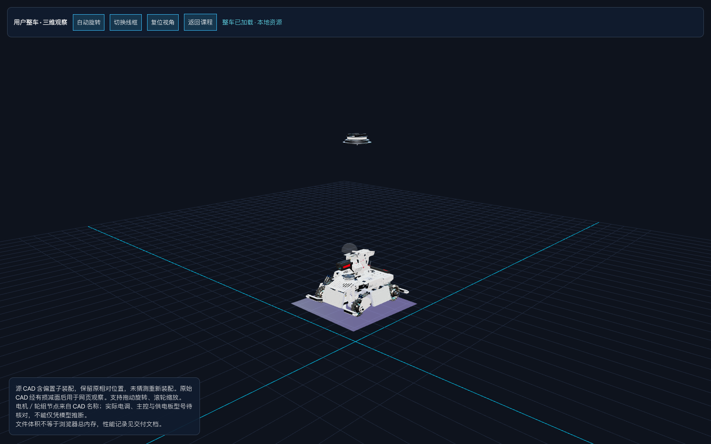

# 第二章设计思路与流程

## 1. 先把教学目标缩小

依据用户《第二章教学定稿 v1.0》，用约14分钟回答：车怎样获得动力、谁决定怎样转、左右轮快慢为何产生转向。不是先教主控型号、CAN帧或PID公式。

十个镜头由讲师手动推进：车架 → 轮组 → 电机 → 驱动器 → 电池/稳压 → STM32 → 三段指令 → 预设运动 → 独立滑块 → 英雄案例对照。预设先于自由调节；滑块不显示RPM、百分比或PWM数字。

## 2. 两套模型分工

- **教学车**：代码生成，轮轴局部原点居中，左轮位于-X、车头为+Z。框架上层开窗，以免遮挡下层电池。电子器件外观与走线为功能示意，不用于施工。
- **整车资产**：只对用户GLB做有损几何简化、移除孤立图片、居中与等比例展示变换。内部节点相对位置保持原样。
- 源CAD中云台下有偏离主体的子装配。页面如实标注，不将它猜测移动回车身。它是用户资产的观察版，而非已验证的装配数字孪生。
- CAD名称可以辅助定位轮组、电机；不能由此推定轮径、主控、电调、电源板型号。未知供电／控制位置不会随便高亮。

## 3. 状态与渲染

`lesson.js`保存十步教学内容、显隐集合与预设；`app.js`维护步骤、输入及暂停；`kinematics.js`计算轮子自转、车身位姿与真实积分轨迹；`viewer.js`只负责将状态绘制成三维画面。

### 坐标一致性

车头+Z、左轮-X、右轮+X、Y向上。右轮更快时车头向-X左偏，绕Y航向角减小。轮子绕自身X轴旋转，不绕车体公转。运动使用带符号归一化速度与帧时间积分；切换相机不触碰运动状态。轨迹有容量上限；无隐式越界瞬移。驶远可手动重置或切跟随镜头。

### 指令与供电

第7步三次点击分别高亮主控、驱动器、电机，传播光点展示主控至驱动器的青色信号与驱动器至电机的橙色功率执行。供电线路独立分色。信号与能量的功能区分**不代表电气隔离**。暂停冻结传播光点，重播回到初始状态。

### 资源策略

单个WebGL上下文，不同时复制多个渲染器。第10步才加载真实整车，加载Promise缓存避免重复请求；离开该步后迟到的加载结果保持隐藏。离开页面释放几何、材质、纹理、控制器和监听器。像素比设置上限，关闭昂贵阴影；轨迹固定容量。

## 4. 模型轻量化流程

原文件只读 → 固定版本 gltfpack 有损简化 → 保留具名节点与材质 → 检查引用 → 删除无材质/纹理引用的孤立图片块 → Khronos glTF Validator → 浏览器视觉核对。

| 指标 | 原文件 | Web整车 |
|---|---:|---:|
| 文件字节 | 216,455,776 | 6,150,804 |
| 文件MiB | 206.43 | 5.87 |
| 独立网格三角面 | 4,320,597 | 213,790 |
| 节点 | 574 | 574 |
| 几何bufferView字节 | 186,928,084 | 5,937,504 |
| 内嵌图片 | 32（未被材质使用） | 0 |

减面有损，不适于测量精度或加工。独立网格面数不等于包含重复实例的屏幕绘制面数；实际整车页约38.4万绘制三角面。文件缩小约97.2%，几何数据约96.8%；不等于浏览器总内存下降同样比例。原文件材质也未引用这32张图，不能把清理它们描述为实际GPU贴图减负。

## 5. 验证与限制

- `npm test`：直行、倒车、左右转、原地转、停止重置、暂停与帧率差异。
- `node scripts/validate_models.mjs`：两份GLB均0错误、0警告。
- `node scripts/browser_check.mjs`：十步节点显隐、轮轴不公转与精确几何贴地、三段指令、预设／滑块同步、暂停、视角保持、迟到异步加载、离线请求、代码抽屉、整车自动旋转及十次往返资源稳定。
- `docs/browser-results.json`记录加载时间、JS堆、几何/纹理/程序数与30帧统计。环境为1600×1000 Chromium无头软件渲染，不是投影电脑GPU；不据此承诺60FPS或进程总内存。
- `docs/model-stats.json`保存字节、几何数据量与SHA256，便于复核。
- 页面截图与仿真视频来自真实网页运行，不是效果图。录像按固定模拟步长采集并编码，无声，不代表真实时间性能。

仍需讲师在目标投影电脑断网走完十步并试讲。完整电池电芯实拍、实车电子部件定位与课堂新人理解反馈未完成，不能用自动化测试替代。
